#  Flashcards App - User Guide

## Application Overview

The Flashcards application is a learning tool designed to help users memorize information through question-and-answer cards organized into categories.

															  
Each card contains a question and a hidden answer. Users can reveal the answer by clicking on the question. A **Copy answer** button then becomes available.

You can add, edit, and delete categories or flashcards at any time.

> The application uses the full CRUD API described [here](../readme.md#api-base-urls).

> A sample dataset containing five categories and five associated flashcards [is available](../readme.md#initialize-the-database).
> Alternatively, you can start with an empty database and create your own library.

  
🔍 Click to see the full screenshot

   
  <a href="img/01-overview.png">
    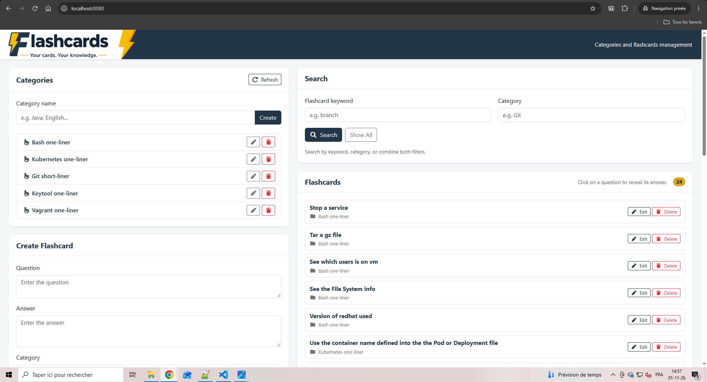
  </a>

---

Here is a short scenario to demonstrate how the application works.

## Filter Flashcards by Category

> Clicking on a category automatically fills in the Category search field.

																			 

The results display all flashcards associated with the selected category.

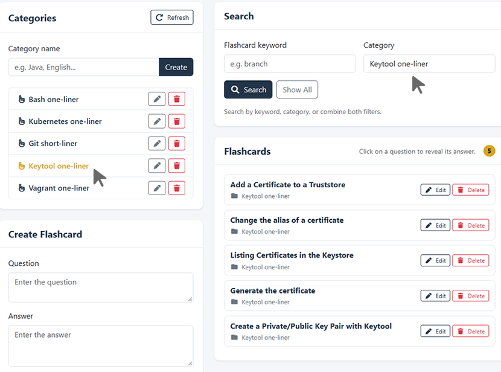

## Edit a Category

> Categories can be renamed at any time.

Click the **Edit** button (pen icon) next to the category.

Rename the category from `Git short-liner` to `Git one-liner`, then click the **Update** button to save your changes. You can also cancel the operation.

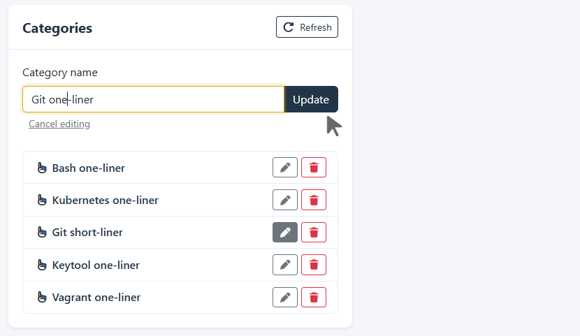

The category name is immediately updated on all associated flashcards.

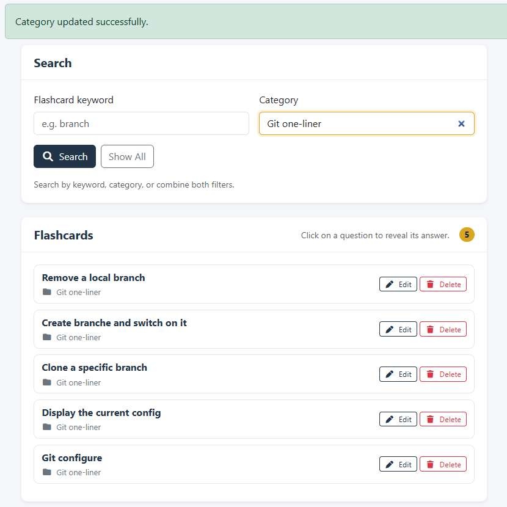

## Search for Flashcards by Keyword

> The application can return multiple matching flashcards.

Enter the keyword `remove` in the search field.

The results include two matching flashcards:
- One from the **Git** category.
- One from the **Vagrant** category.

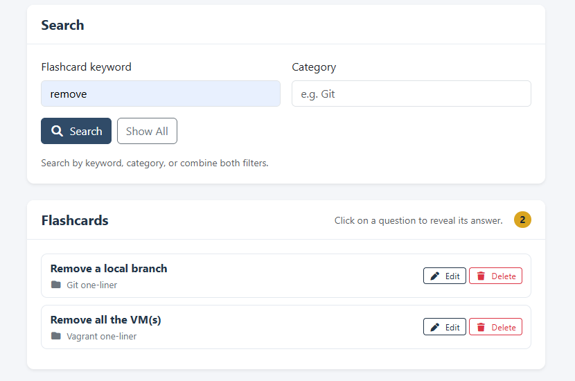

### Refine the Search Using a Category Filter

Enter part of a category name, such as `vag`, in the Category field.

The results are filtered further, and only one flashcard remains: the matching flashcard from the **Vagrant** category.

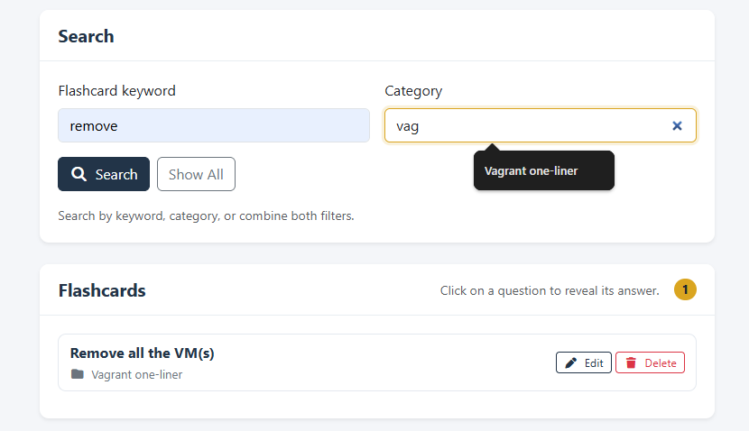

## Create a Category

> Categories allow flashcards to be grouped by topic.

Enter `Github Actions` in the **Category name** field and click the **Create** button.

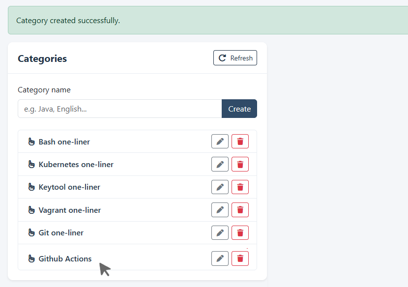

The new category immediately appears in the category list.

## Create a Flashcard

> A flashcard consists of a question, an answer, and an associated category.

Enter the question, the answer, select the category, and click on the button **+ Create Flashcard**

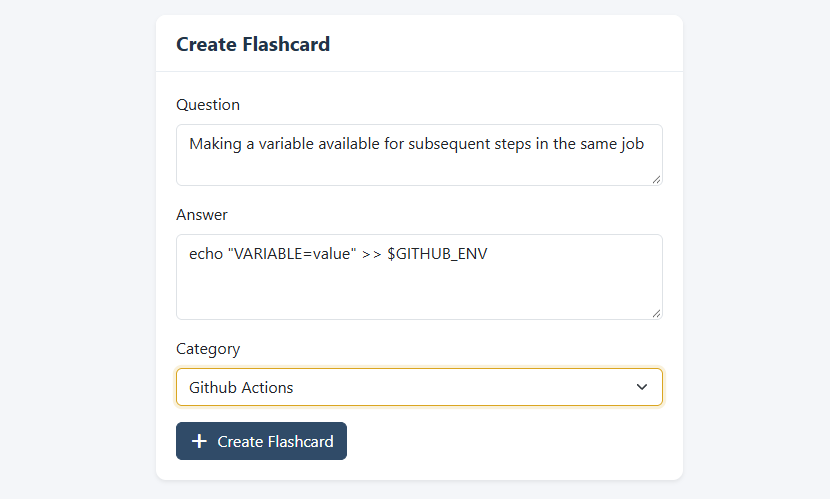

A notification confirms that the flashcard has been created.

If it is not immediately visible because there are many entries, click on its category to find it.

## Search Across Multiple Categories

> The category search supports partial matching.

Example with **Git one-liner** category and the new one created and called **Github Actions**, the results show all these matches.

You can type a few letters of a category name to display matching results and autocomplete suggestions.

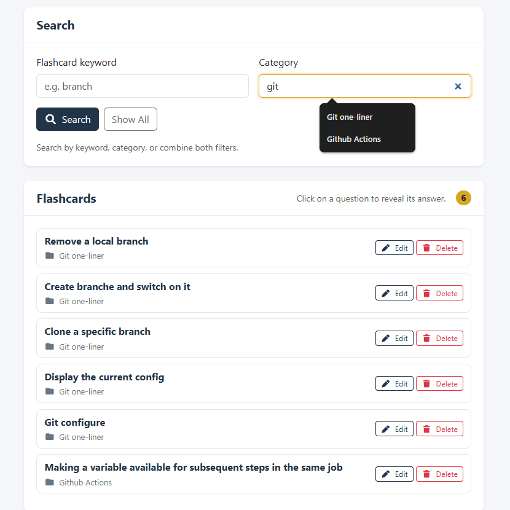

## Reveal and Copy a Flashcard Answer

> Flashcard answers are hidden by default. This allows users to test their knowledge before revealing the answer.

Click on the question title to reveal the answer. A **Copy answer** button becomes available.

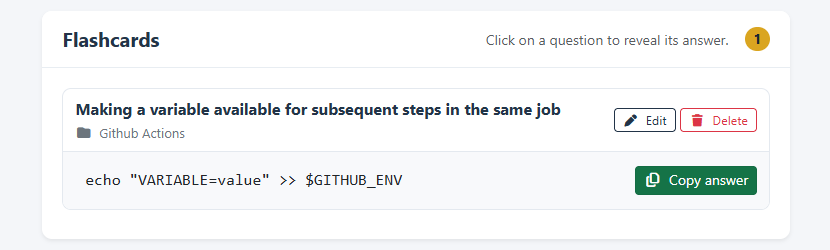

A notification confirms that the answer has been copied successfully.

You can now paste it directly into your workflow, terminal, or another tool.

## Edit a Flashcard

For example, find the flashcard in the **Github Actions** category.

Click the **Edit** button and modify the question, answer, or category. Click **Save Changes**.

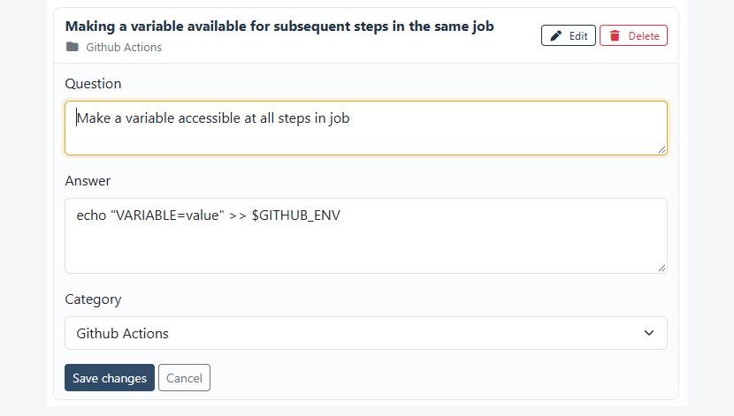

## Remove a Flashcard or a Category

The application supports two deletion operations.
																																		

### Delete a Flashcard

Deleting a flashcard removes only the selected flashcard.

Other flashcards in the same category remain unchanged.

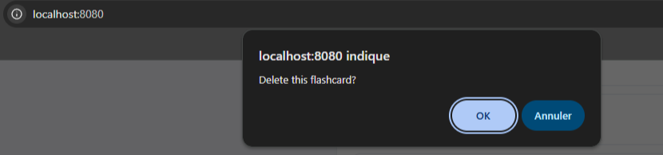

### Delete a Category

Deleting a category also deletes all flashcards associated with it.

Before deleting a category, the application displays a warning to inform the user of the consequences.
	 
**Warning:** This action cannot be undone.

It is recommended to delete or move the flashcards to another category before deleting a category.

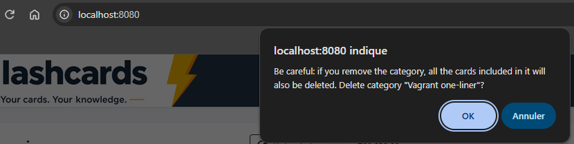

---

> Flashcards help you learn at your own pace!
